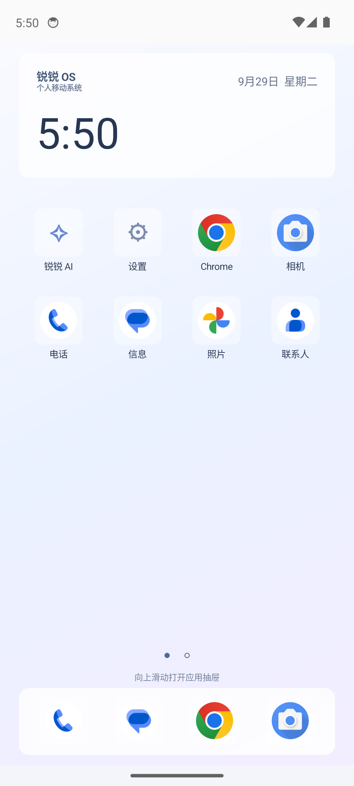
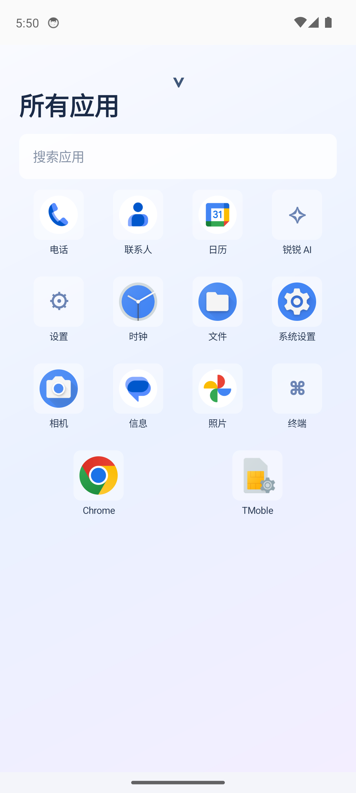

# 锐锐 OS · RuiRui OS

**面向 Windows 上 Android Emulator 的安卓桌面与 AI 系统交互原型。**

浅蓝色、圆角和玻璃质感，是这个项目的视觉方向。使用手机式桌面与应用抽屉，配置自己的模型，让 AI 通过控制桥查询和操作安卓环境。

> 当前版本：**1.0-alpha12，实验性原型**。项目由 Google 官方 Android 14 模拟器镜像、原生 Android 应用、系统资源覆盖层、开机动画和 Windows 控制桥组成。**没有自行编译完整 AOSP 系统镜像，不是可以直接刷入手机的 ROM。** APK 是其中的应用组件，Release 提供整套原型部署包，不包含 Google 系统镜像。

作者：[锐锐 / 锐锐酱 · Chanray-May9](https://github.com/Chanray-May9)

[下载部署包](https://github.com/Chanray-May9/RuiRui-OS/releases) · [反馈问题](https://github.com/Chanray-May9/RuiRui-OS/issues) · [已知限制](#已知限制)

## 预览

以下为原型开发过程中的模拟器截图，局部界面可能与当前版本不同。

<p> </p>

## 功能

| 模块 | 当前实现 |
| --- | --- |
| 桌面 | 原生 Android 界面，左右分页、上滑应用抽屉、应用搜索和启动 |
| 外观 | 浅蓝配色、圆角、玻璃风格卡片，可切换深色；并非所有区域都有实时模糊 |
| 设置 | 独立设置入口；模型、请求参数和授权集中在「锐锐 AI」子菜单 |
| 系统界面 | 针对开发用 Android 14 镜像的通知/快捷设置资源覆盖层及部分系统图标；不是全量重写 SystemUI |
| 开机体验 | 人物主题动画铺满屏幕；浅蓝文字「马上就好」「一切交给锐锐」「正在开机」顺序淡入淡出 |
| AI 聊天 | 打开锐锐 AI 即进入聊天，支持兼容 Chat Completions 的接口及 SSE 流式文本 |
| 思维强度 | 聊天中选择 off / low / medium / high，实际支持由模型提供方决定 |
| 悬浮交互 | 任务运行时显示边缘光效与顶端状态胶囊；点击胶囊，在同一卡片内输入补充内容 |
| 会话历史 | 小入口打开全屏历史列表，数据保存在应用私有存储 |
| 后台任务 | 已移除离开页面时取消任务的逻辑；返回会话应恢复运行状态与停止按钮，仍需更多回归验证 |
| 系统操作 | 查询设备、执行 Android shell、启动应用、修改设置，以及通过 input 等命令点击和滑动 |
| 授权 | 普通模式逐批确认命令；设置中手动开启完全控制后，不再逐批确认 |
| 终端 | 内置 Android 命令入口，通过 Windows 本机 ADB 控制桥执行 |
| 助手入口 | 已接入 VoiceInteractionService，并配置模拟器长按电源键手势；实际唤起尚待完整验证 |
| 语言 | 简体中文为主，提供英文切换，部分新增文案尚未完整翻译 |

AI 操作采用「模型输出 JSON 命令 → 控制桥执行 → 返回 stdout / stderr / exitCode → 模型继续」的循环，不是通用原生工具调用协议。应用不在本地运行大模型；推理请求发往你配置的服务。

## 在 Windows 模拟器上使用

### 1. 准备环境

已有 SDK 和合适 AVD 的用户可以跳到第 3 步。需要：

- Windows x64，CPU 虚拟化已开启。
- **PowerShell 7**，命令为 `pwsh`。
- Android SDK 的 **Android Emulator** 和 **Platform-Tools**。
- **Android 14 / API 34 / Google APIs / x86_64** 系统镜像。
- 一个专门用于本项目的虚拟设备，避免影响已有模拟器数据。

可通过 [Android Studio](https://developer.android.com/studio) 的 SDK Manager 和 Device Manager 安装组件。运行原型时不用一直打开 Android Studio。参考 [AVD 创建文档](https://developer.android.com/studio/run/managing-avds) 和 [模拟器加速文档](https://developer.android.com/studio/run/emulator-acceleration)。

**请选择 Google APIs 镜像，不是 Google Play 镜像。** 完整部署依赖可 root、可 remount 的开发镜像；Google Play 镜像通常不允许 `adb root`。Google 镜像由用户自行从官方获取，其中的服务不由本项目重新分发，也不代表包含 Play 商店。

开发环境使用 API 34 Google APIs x86_64 **revision 14**。其他修订版的 SystemUI 资源可能不同。

SDK 不在默认位置时，在 PowerShell 中指定：

```powershell
$env:ANDROID_HOME = "D:\Android\Sdk"
```

脚本按 `-SdkPath`、`ANDROID_HOME`、`ANDROID_SDK_ROOT`、当前用户 LocalAppData 下的 `Android\Sdk` 顺序寻找 SDK。

### 2. 创建模拟器

在 Android Studio 的 Device Manager 中创建：

| 项目 | 配置 |
| --- | --- |
| 设备 | Pixel 7 |
| 镜像 | Android 14 / API 34 / Google APIs / x86_64 |
| AVD 名称 | `RuiruiOS_API34` |
| 内存 / CPU | 2048 MB / 2 核 |
| 数据分区 | 8 GB |
| 屏幕 | 1080 × 2400，竖屏 |

创建后先关闭模拟器窗口，由项目脚本以可写系统模式启动。

已安装 Android SDK Command-line Tools 的用户也可以使用命令行：

```powershell
$sdk = $env:ANDROID_HOME
# 未设置 ANDROID_HOME 时：
# $sdk = Join-Path $env:LOCALAPPDATA "Android\Sdk"

& "$sdk\cmdline-tools\latest\bin\sdkmanager.bat" --licenses
& "$sdk\cmdline-tools\latest\bin\sdkmanager.bat" `
  "platform-tools" "emulator" "system-images;android-34;google_apis;x86_64"

"no" | & "$sdk\cmdline-tools\latest\bin\avdmanager.bat" create avd `
  --name RuiruiOS_API34 `
  --package "system-images;android-34;google_apis;x86_64" `
  --device pixel_7
```

SDK 许可需要自行阅读并接受。找不到 `pixel_7` 时，用 `avdmanager.bat list device` 查看可用设备或使用图形界面创建。命令行创建后的分区大小可在 Device Manager 中调整；项目启动脚本会指定 2 GB RAM 和 2 核 CPU。

想将 AVD 数据存到其他磁盘，请在**创建前**设置：

```powershell
$env:ANDROID_AVD_HOME = "D:\RuiRuiOS\avd"
New-Item -ItemType Directory -Force $env:ANDROID_AVD_HOME | Out-Null
```

之后在相同环境中创建、启动，或向启动脚本传入 `-AvdHome`。仅更改环境变量不会自动搬迁已有虚拟设备。

### 3. 下载完整部署包

在 [Releases](https://github.com/Chanray-May9/RuiRui-OS/releases) 下载 **RuiRuiOS-alpha12-windows-runtime.zip**，解压到有空间的目录，例如 `D:\RuiRuiOS\release`。

包内包含主应用、系统界面覆盖层、开机动画和 Windows 脚本。**一次统一安装，自带的主题、图标和开机动画同时部署，正常开机自动加载，不需要分别开启。** 单独安装 APK 只能得到应用组件。

### 4. 首次统一安装

用 **PowerShell 7** 进入解压目录：

```powershell
cd D:\RuiRuiOS\release

# 启动已经创建好的 AVD。
pwsh -NoProfile -ExecutionPolicy Bypass -File .\Start-RuiRuiOS.ps1

# 首次统一部署，包含系统界面资源与开机动画。
pwsh -NoProfile -ExecutionPolicy Bypass -File .\Install-RuiRuiOS.ps1

# 进入桌面并启动 AI 控制桥。
pwsh -NoProfile -ExecutionPolicy Bypass -File .\Start-RuiRuiOS.ps1
```

第一次启动若发现应用未安装，脚本会保持模拟器运行并提示进行安装。安装器会设置默认桌面、写入覆盖层和开机动画、配置助手入口。挂载系统资源过程中会重启，请等待完成。Android 系统语言可在系统设置中修改，锐锐应用默认简体中文。

默认移除当前模拟器用户的 YouTube、YouTube Music、Drive、Maps、Gmail 和 Google Search，保留 Google 服务框架及镜像中可用的浏览器、相机等应用。应用是否原本存在取决于镜像。保留全部预装 Google 应用可使用：

```powershell
pwsh -File .\Install-RuiRuiOS.ps1 -KeepGoogleApps
```

### 5. 日常启动

安装后只运行：

```powershell
pwsh -NoProfile -ExecutionPolicy Bypass -File .\Start-RuiRuiOS.ps1
```

开机动画随 Android 冷启动播放，从桌面重新打开 AI 不会播放开机动画。日常启动不会主动重装或 force-stop 正在工作的 AI；安装更新则需要等待任务结束或在聊天中手动停止。

自定义路径、设备名和端口：

```powershell
pwsh -File .\Start-RuiRuiOS.ps1 `
  -SdkPath "D:\Android\Sdk" -AvdName "RuiruiOS_API34" `
  -AvdHome "D:\RuiRuiOS\avd" -Port 5554

pwsh -File .\Install-RuiRuiOS.ps1 `
  -SdkPath "D:\Android\Sdk" -Serial emulator-5554
```

默认目标是 `emulator-5554`。安装器和控制桥必须选择同一个模拟器。Android 应用固定通过 `10.0.2.2:18765` 访问 Windows 主机，一个主机上只支持一个使用该端口的控制桥。

## AI 配置与使用

### 模型连接

打开 **设置 → 锐锐 AI**：

| 配置 | 用法 |
| --- | --- |
| 基准 URL | 例如 `https://api.example.com/v1`；也接受完整 `/chat/completions` 地址 |
| API 密钥 | 使用自己的服务商密钥；需要认证时发送 Bearer 请求头 |
| 模型名称 | 服务商提供的准确模型 ID，不是显示昵称 |
| 自定义请求头 JSON | 可选；值必须为字符串 |
| 兼容配置 JSON | 可选参数，例如 `{"temperature":0.7}` |
| 超时 | 10–300 秒，默认 90 秒 |
| 思维强度 | off / low / medium / high，也可在聊天页切换 |

保存后使用「检查模型连接」，再打开桌面的锐锐 AI 聊天。接口需要兼容 **Chat Completions**，并非支持所有厂商私有协议，也不是原生 Responses API 客户端。本机模型服务通常通过 `10.0.2.2` 访问 Windows 主机，模拟器中的 `127.0.0.1` 指模拟器自己。

`off` 表示客户端不主动添加 `reasoning_effort`，**不保证模型自身停止内部推理**。额外 JSON 中手动设置的同名参数也不会被 off 删除。模型不支持思维参数时，改回 off 并检查额外 JSON。

### 系统控制

控制桥在 Windows 上调用 ADB，将命令交给目标 Android 环境。普通模式逐批确认，在设置中手动开启完全控制后不再逐批询问。

示例：“打开浏览器搜索 Android 官方文档”“把亮度调低一点”“查看已安装应用”“查询当前网络状态”。

成功率受模型能力、应用界面、权限和设备命令支持情况影响。命令错误与退出码显示在聊天中，模型宣称完成不能替代实际执行结果。

### 运行、补充与历史

- 「停止」取消模型请求并停止后续命令，已经发出的系统命令不一定能撤回。
- 返回主页、切换应用、重新进入聊天不应主动取消任务；当前已修复相关逻辑，仍需要回归验证。
- 点击原有状态胶囊，在同一卡片内补充内容并点发送图标。内容会在后续模型交互和命令间隙纳入，无法即时改写在途请求或撤回已执行命令。
- 「历史」打开全屏会话列表，不占用半屏侧栏。
- 运行状态目前在进程内维护。**强制停止应用、系统杀进程、关闭模拟器或 Windows 重启后，不支持自动恢复正在执行的任务。** 本地历史可保留，清除应用数据或卸载会删除它。

## 资源占用

开发配置为模拟器 2 GB RAM、2 核 CPU、8 GB 数据分区。Windows、图形渲染、虚拟化和其他程序会额外占用主机内存；SDK、系统镜像、数据盘、下载包及构建缓存都占磁盘。

这里不下载完整 AOSP 源码，构建本项目的应用与覆盖层不需要 WSL 或 Linux。**没有验证整台电脑总内存低于 6 GB、磁盘总用量低于 70 GB，不承诺这些硬上限。**

## 从源码构建

```powershell
git clone https://github.com/Chanray-May9/RuiRui-OS.git
cd RuiRui-OS
```

除运行环境之外，需要 **JDK 17 或更新版本、SDK Platform 35、Build-Tools 36.0.0**。确保 `javac`、`jar`、`keytool` 在 PATH 中：

```powershell
& "$env:ANDROID_HOME\cmdline-tools\latest\bin\sdkmanager.bat" `
  "platforms;android-35" "build-tools;36.0.0"

pwsh -File .\Build-RuiRuiOS.ps1
# 先启动目标 API 34 Google APIs 模拟器，再构建覆盖层：
pwsh -File .\Build-RuiRuiSystemUI.ps1
```

编译 SDK 35 与运行镜像 API 34 是两个不同概念。脚本不要求 Gradle，输出三个 APK 到仓库根目录，临时构建位于 `.build`。首次构建会在当前用户 LocalAppData 下的 `RuiRuiOS` 目录生成开发签名密钥，不提交到仓库。

自编译签名通常与发布版不同，不能直接覆盖安装。建议使用新的测试 AVD；卸载旧应用再安装会丢失配置和聊天记录。

完整部署还需要从 Release 运行包取得 `bootanimation.zip`。此版本提供动画成品，**不包含动画制作工程**。

```text
android-app/                  原生 Java 应用、Manifest、壁纸
systemui-overlay/             SystemUI 覆盖层源码
framework-overlay/            部分系统图标覆盖层源码
Build-RuiRuiOS.ps1             构建主应用
Build-RuiRuiSystemUI.ps1        从目标模拟器资源构建覆盖层
Install-RuiRuiOS.ps1           首次统一部署与更新
Start-RuiRuiOS.ps1             日常启动模拟器与控制桥
RuiRuiOS-ControlBridge.ps1     本机 Android 命令控制桥
Tools.Common.ps1              SDK 解析和公共脚本函数
docs/images/                  原型截图
```

## 常见问题

**adb root 不可用 / remount 提示只读**

检查是 Google APIs 开发镜像，并用项目脚本以 `-writable-system` 启动。按 ADB 提示完成 disable-verity / reboot / remount 后重试统一安装。只对专用模拟器操作，不要把该流程用于真机。

**彻底关闭模拟器后系统资源恢复默认**

Android Emulator 的可写系统层和镜像版本会影响持久性，当前尚未保证所有环境的冷启动持久性。保留数据并重跑统一安装器可重新部署，界面中不需要逐项开启主题。参考 [官方模拟器命令行说明](https://developer.android.com/studio/run/emulator-commandline)。

**能聊天但控制不了系统**

检查设置中的系统通道状态，也可前台运行控制桥查看错误：

```powershell
pwsh -File .\RuiRuiOS-ControlBridge.ps1 -Serial emulator-5554
# 另开一个 PowerShell：
Invoke-RestMethod http://127.0.0.1:18765/health
```

`root` 应为 true；`authorized` 为 false 是普通确认模式，不是连接失败。端口被占用时，不要重复启动多个桥，先确认已有桥是否连接正确的模拟器。

**命令报 Segmentation fault / 退出码 139**

开发过程中出现过，尚未定位根因。这不代表任务成功。请记录命令、镜像版本和复现步骤，在 Issues 中反馈，隐藏密钥和私人聊天。

**HTTP 401、404 或未知参数**

分别检查密钥、接口路径和模型 ID，以及思维强度与额外 JSON。厂商协议不兼容时需要新增适配。

**长按电源键没有唤起锐锐**

已接入系统助手服务并配置手势，完整交互尚未确认。可在系统默认数字助理设置中检查是否选中锐锐。品牌电源键逻辑各异，没有跨品牌保证。

**覆盖层导致 SystemUI 不正常**

停止任务后，在专用模拟器中移除本项目两个覆盖层文件并重启，可退回原始 SystemUI：

```powershell
$adb = Join-Path $env:ANDROID_HOME "platform-tools\adb.exe"
& $adb -s emulator-5554 root
& $adb -s emulator-5554 remount
& $adb -s emulator-5554 shell rm -f /product/overlay/RuiRuiSystemUI.apk /product/overlay/RuiRuiFramework.apk
& $adb -s emulator-5554 reboot
```

默认桌面可从 Android 的默认应用设置切换。被移除的可选 Google 应用可用 `adb shell cmd package install-existing --user 0 包名` 恢复。

## 已知限制

1. 无完整系统镜像、Recovery、OTA、厂商内核或真机驱动适配，不支持直接刷机。
2. 当前只有 Windows + Android Emulator 控制通道，手机只安装 APK 不能获得模拟器 root 能力。
3. 任务不是跨进程/跨重启持久化引擎。返回会话、停止按钮、追加指令和电源键入口仍需端到端验证。
4. 此次公开目录已构建主应用和两套覆盖层、检查脚本语法；**未完成全新 AVD 的统一安装回归**。
5. 单次任务最多 8 轮，每轮最多 8 条命令，单条命令约 30 秒超时。达到上限、网络错误、拒绝授权等也可能结束任务。
6. 系统资源依赖目标镜像版本，并未彻底重做所有系统页面。命令通道退出码 139 尚未解决。
7. 控制桥绑定回环地址，但**没有客户端身份认证**；本机其他进程可能调用它，不能将界面确认视为对恶意本机客户端的安全隔离。不要向局域网或公网开放。
8. 配置和历史保存在应用私有存储，没有额外应用层加密。请求发送给用户配置的模型服务；Google 镜像服务遵循各自条款。
9. 英文翻译、无障碍、语音输入与跨品牌兼容未完成；当前助手以文字交互为主。

## 参与项目

欢迎 Issues 与 Pull Requests。请提供镜像 API/修订版、模拟器版本、复现步骤、期望和实际结果，隐藏个人数据。

后续方向包括：将 AI 引擎从 Activity 彻底拆出、补齐生命周期回归、定位退出码 139、完善系统界面、无障碍与可复现系统镜像构建路线。

## 许可证

原创代码按 [MIT License](LICENSE) 开源。人物形象、壁纸、动画及截图中的第三方界面/标识不自动适用代码许可证，参见 [素材与第三方说明](NOTICE.md)。Android、Google 服务和官方镜像遵循各自许可，本项目不代表 Google、Apple 或 Samsung 的认证或背书。
